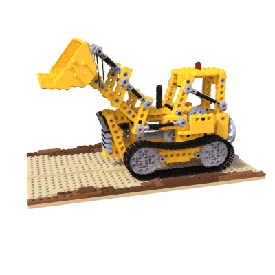

# Inverting Neural Radiance Fields

iNeRF is a framework for mesh-free pose estimation that queries a pretrained Neural Radiance Field (NeRF) to optimize camera position.

## Installation

```console
git clone https://github.com/bareform/dependencies.git
conda update -n base -c defaults conda
conda env create -f dependencies/environment.yml
conda activate bareform

git clone https://github.com/bareform/inerf.git
cd inerf
```

<details>
  <summary> Dependencies (click to expand) </summary>
  
  ## Dependencies
  - Python 3.10
  - imageio[ffmpeg]
  - numpy
  - torch
    
</details>

## Quick Start

To perform pose estimation of a scene generated by a `lego` NeRF, download our pretrained `lego` NeRF [here](https://huggingface.co/luethan2025/nerf/lego).

After training for 100 iterations, you can find results similiar to gif at `./assets/lego/lego.gif`.



You can use the provided Jupyter Notebook `inference.ipynb` to estimate some poses.

## Method

[Inverting Neural Radiance Fields for Pose Estimation](https://arxiv.org/abs/2012.05877)

Lin Yen-Chen<sup>1</sup><sup>2</sup>, Pete Florence<sup>1</sup>, Jonathan T. Barron<sup>1</sup>, Alberto Rodriguez<sup>2</sup>, Phillip Isola<sup>2</sup>, Tsung-Yi Lin<sup>1</sup>

<sup>1</sup>Google Research, <sup>2</sup> Massachusetts Institute of Technology

> We present iNeRF, a framework that performs mesh-free pose estimation by "inverting" a Neural RadianceField (NeRF). NeRFs have been shown to be remarkably effective for the task of view synthesis - synthesizing photorealistic novel views of real-world scenes or objects. In this work, we investigate whether we can apply analysis-by-synthesis via NeRF for mesh-free, RGB-only 6DoF pose estimation - given an image, find the translation and rotation of a camera relative to a 3D object or scene. Our method assumes that no object mesh models are available during either training or test time. Starting from an initial pose estimate, we use gradient descent to minimize the residual between pixels rendered from a NeRF and pixels in an observed image. In our experiments, we first study 1) how to sample rays during pose refinement for iNeRF to collect informative gradients and 2) how different batch sizes of rays affect iNeRF on a synthetic dataset. We then show that for complex real-world scenes from the LLFF dataset, iNeRF can improve NeRF by estimating the camera poses of novel images and using these images as additional training data for NeRF. Finally, we show iNeRF can perform category-level object pose estimation, including object instances not seen during training, with RGB images by inverting a NeRF model inferred from a single view. 

## Citation

The original paper can be found at:
```
@inproceedings{yenchen2021inerf,
    title={iNeRF: Inverting Neural Radiance Fields for Pose Estimation},
    author={Lin Yen-Chen and Pete Florence and Jonathan T. Barron and Alberto Rodriguez and Phillip Isola and Tsung-Yi Lin},
    year={2021},
    eprint={2012.05877},
    archivePrefix={arXiv},
    primaryClass={cs.CV}
}
```
